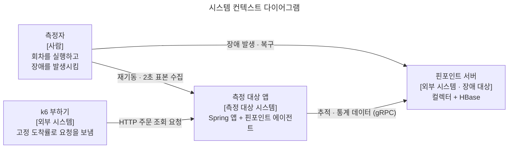
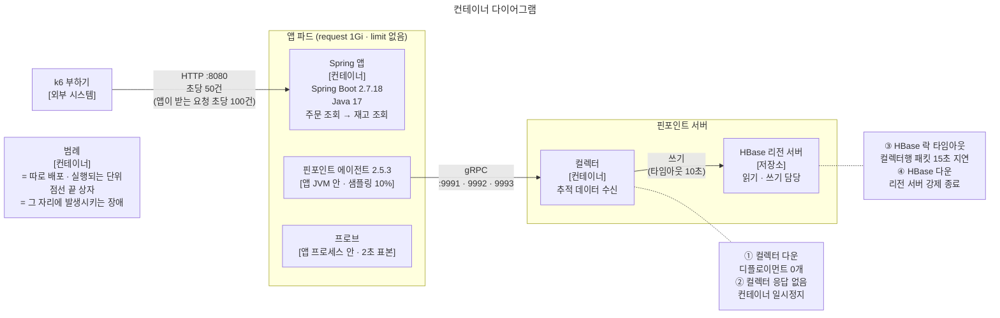
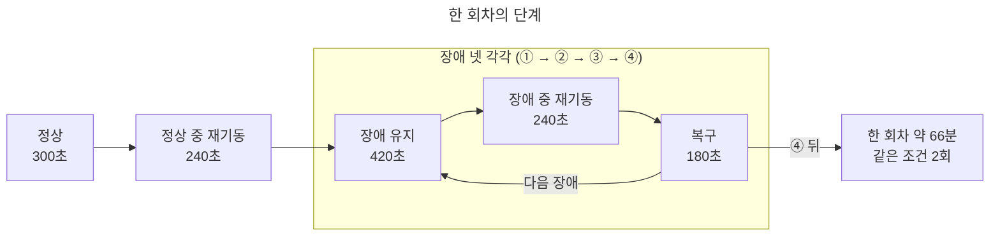

# pinpoint-storage-outage-lab

핀포인트 서버(컬렉터 · HBase)가 장애일 때 에이전트를 붙인 Spring 앱의 연결 · 스레드 · 메모리가 어떻게 변하는지 재현해 측정한 랩입니다.

## 요약

**핀포인트 장애 넷 모두에서 앱에 커넥션 · 스레드 · 메모리가 쌓이지 않았습니다.** 같은 조건 2회차가 같은 결과를 냈습니다.

| 장애 | 앱이 받은 연결 · 요청 | 스레드 | 컬렉터 연결 | 메모리 | 장애 중 재기동 |
|---|---|---|---|---|---|
| 컬렉터 다운 | 정상과 같음 | 정상과 같음 | 0개로 줄어듦 | 쌓이지 않음 | 정상 재기동과 같음 (RSS 증가 ※) |
| 컬렉터 응답 없음 | 정상과 같음 | 정상과 같음 | 4 → 5 에서 멈춤 ※ | 2회차만 +12MB ※ | 정상 재기동과 같음 |
| HBase 락 타임아웃 | 정상과 같음 | 정상과 같음 | 정상과 같음 (4개) | 쌓이지 않음 | 정상 재기동과 같음 (2회차 RSS 증가 ※) |
| HBase 다운 | 정상과 같음 | 정상과 같음 | 3개로 줄어듦 | 쌓이지 않음 | 정상 재기동과 같음 (RSS 증가 ※) |

→ 「핀포인트 장애가 앱에 커넥션을 물려 메모리를 키웠다」는 추정은 이 재현에서 성립하지 않습니다.

※ 표시는 정상 구간보다 늘어난 칸이고, 판정 기준을 적용한 근거는 [5절](#5-결론)과 [판정 기준 적용](docs/details.md#판정-기준-적용)에 있습니다. 앱이 받은 연결 · 요청 열의 「정상과 같음」은 받은 연결 최대 51\~55, 요청 평균 5.6\~6.0ms, 오류 0 입니다.

앱 메모리 최대는 RSS 329MB 로 파드 request 1Gi 의 32% 였습니다. 스레드 수가 같은데 스레드 스택이 최대 14MB 커진 파드가 있었습니다. 장애와의 인과는 확인되지 않았고, 장애가 이어져도 더 늘지 않았습니다([4.4](docs/details.md#44-스레드-스택)).

## 1. 목적

**과거에 「핀포인트 장애가 앱에 커넥션을 물려 메모리를 키웠다」고 추정한 원인이 맞는지 재현으로 판정합니다.**

쿠버네티스에 올린 Spring 서비스들의 노드가 반복해서 죽던 때가 있었습니다. 당시 모든 서비스에 핀포인트 에이전트가 붙어 있었고, 핀포인트 서버에서는 세 가지 장애가 실제로 일어났습니다: 컬렉터 다운, HBase 락 타임아웃, HBase 다운. 원인을 핀포인트로 추정해 TTL 조정 · 테이블 정리 같은 조치를 하다가 결국 핀포인트를 걷어냈고, 원인은 확인하지 못했습니다.

| 질문 | 판정에 쓰는 비교 |
|---|---|
| ① 핀포인트 장애 때문에 앱에 커넥션이 물리는가 | 정상 ↔ 장애 넷 ([「장애」](docs/details.md#장애)) |
| ② 물린다면 무엇이 쌓이는가 | 장애끼리, 그리고 장애 중 재기동 ↔ 정상 재기동 |
| ③ 아니라면 남는 원인 후보는 무엇인가 | 이 랩이 배제한 범위와 배제하지 못한 범위 |

**판정 기준 (실행 전에 정함)**

장애 구간에서 아래 중 하나라도 정상 구간보다 늘고, 장애를 복구하면 돌아오면 「물린다」로 판정합니다.

| 지표 | 왜 보나 |
|---|---|
| 앱이 받은 연결 · 처리 중 요청 · 요청 처리 시간 | 「요청이 쌓여 커넥션이 늘었다」는 원래 추정을 그대로 잰다. |
| 컬렉터로 가는 연결 수 (상태별) | 재연결이 쌓이는가 |
| 스레드 수 (핀포인트 · Tomcat) | 연결 · 요청을 붙잡는 것은 결국 스레드다. |
| RSS · 힙 · 네이티브 메모리 구역 | 무엇이 쌓였는지 구역으로 나눈다. |

## 2. 구성

용어 · 구성 값 · 장애 재현 방법 표는 [상세 문서의 구성과 절차](docs/details.md#구성과-절차)에 있습니다. HBase 락 타임아웃은 컨테이너 일시정지가 ZooKeeper 세션 상한(이 구성에서 40초)을 넘기면 리전 서버가 스스로 종료해 「멈췄다가 다운」이 되므로, 컬렉터로 가는 패킷을 컬렉터의 HBase 타임아웃(10초)보다 늦게 오게 만들었습니다([상세](docs/details.md#장애)).

## 3. 절차

단계 길이는 「변화가 나타날 시간」이 아니라 에이전트 타이머가 한 주기 이상 지나는 시간으로 정했습니다. 단계별 근거와 보는 지표 표는 [상세 문서의 단계 길이](docs/details.md#단계-길이)에 있습니다.

## 4. 결과

같은 조건으로 2회 실행했습니다. 표의 값은 「1회차 / 2회차」 순서입니다. 회차별 전체 표 · 로그 · 그래프는 `docs/results/` 에 있습니다. 해석과 나머지 표는 [상세 문서의 결과](docs/details.md#결과)에 있습니다.

### 4.1 장애가 실제로 걸렸는가

판정하기 전에, 앱 쪽이 평탄한 것이 「장애가 안 걸려서」가 아닌지 확인했습니다.

| 장애 | 걸렸다는 증거 (두 회차 모두 남음) |
|---|---|
| 컬렉터 다운 | 에이전트 명령 스트림 실패(`UNAVAILABLE: io exception`) 반복, 컬렉터 연결 0개 (유지 단계 표본 210개 중 203개) |
| 컬렉터 응답 없음 | 에이전트 정보 전송의 응답 대기 시간 초과(1회차는 장애 중 재기동 단계에서), keepalive 실패 경고 |
| HBase 락 타임아웃 | 컬렉터의 HBase 쓰기마다 메타 조회 락 10초 초과, 유지 단계 WARN · ERROR 206 · 213건 |
| HBase 다운 | 리전 서버 연결 거부(`failed on connection exception`) 26 · 26건, HBase 컨테이너 메모리 1.7GB → 0.36GB (1회차) |

### 4.2 앱 자원

| 단계 | 받은 연결 최대 | 처리 중 최대 | 요청 평균(ms) | 오류 | 스레드 최대 (Tomcat) | 컬렉터 연결 ESTAB · SYN_SENT 최대 |
|---|---|---|---|---|---|---|
| 정상 | 53 / 54 | 8 / 7 | 5.7 / 5.7 | 0 / 0 | 47 (10) / 47 (10) | 4 · 0 / 4 · 0 |
| 정상 중 재기동 | 54 / 54 | 6 / 8 | 5.7 / 5.7 | 0 / 0 | 48 (10) / 47 (10) | 4 · 0 / 4 · 0 |
| 컬렉터 다운 | 52 / 53 | 4 / 6 | 5.7 / 5.7 | 0 / 0 | 46 (10) / 45 (10) | 4 · 0 / 4 · 0 |
| 컬렉터 다운 중 재기동 | 54 / 53 | 6 / 7 | 5.7 / 5.7 | 0 / 0 | 47 (10) / 46 (10) | 0 · 4 / 0 · 4 |
| 컬렉터 복구 | 55 / 52 | 12 / 2 | 5.6 / 5.7 | 0 / 0 | 49 (14) / 44 (10) | 4 · 0 / 4 · 0 |
| 컬렉터 응답 없음 | 52 / 53 | 4 / 6 | 5.6 / 5.7 | 0 / 0 | 50 (14) / 45 (10) | 5 · 0 / 5 · 0 |
| 컬렉터 응답 없음 중 재기동 | 52 / 54 | 4 / 8 | 5.7 / 5.8 | 0 / 0 | 50 (14) / 45 (10) | 5 · 0 / 5 · 0 |
| 컬렉터 응답 복구 | 51 / 55 | 3 / 9 | 5.6 / 5.7 | 0 / 0 | 44 (10) / 44 (10) | 4 · 0 / 4 · 0 |
| HBase 락 타임아웃 | 52 / 53 | 4 / 5 | 5.6 / 5.7 | 0 / 0 | 45 (10) / 45 (10) | 4 · 0 / 4 · 0 |
| HBase 락 타임아웃 중 재기동 | 54 / 52 | 8 / 6 | 5.8 / 5.7 | 0 / 0 | 48 (10) / 48 (10) | 4 · 0 / 4 · 0 |
| HBase 락 타임아웃 해제 | 53 / 52 | 5 / 4 | 5.7 / 5.9 | 0 / 0 | 45 (10) / 45 (10) | 4 · 0 / 4 · 0 |
| HBase 다운 | 52 / 51 | 4 / 3 | 5.6 / 5.9 | 0 / 0 | 45 (10) / 45 (10) | 3 · 0 / 3 · 0 |
| HBase 다운 중 재기동 | 54 / 54 | 6 / 8 | 5.8 / 6.0 | 0 / 0 | 48 (10) / 47 (10) | 4 · 0 / 4 · 0 |
| HBase 복구 | 53 / 52 | 6 / 4 | 5.8 / 5.9 | 0 / 0 | 45 (10) / 45 (10) | 4 · 0 / 4 · 0 |

앱 메모리 최대는 RSS 329MB 로 파드 request 1Gi 의 32% 였습니다. 컬렉터 연결 · 스레드 칸의 해석과 메모리 표는 [상세 문서 4.2](docs/details.md#42-앱-자원)에 있습니다.

### 4.3 기동 · 4.4 스레드 스택 · 4.5 서버 쪽 메모리

| 항목 | 판정 |
|---|---|
| [4.3 기동](docs/details.md#43-기동) | 장애 중 재기동도 정상 재기동과 같았습니다 (기동 CPU 5.3\~7.0초, 재연결 폭주 없음). |
| [4.4 스레드 스택](docs/details.md#44-스레드-스택) | 스레드 수가 같은데 스레드 스택이 최대 14MB 커진 파드가 있었습니다. 장애와의 인과는 확인되지 않았고, 장애가 이어져도 더 늘지 않았습니다. |
| [4.5 서버 쪽 메모리](docs/details.md#45-서버-쪽-메모리) | HBase 다운 단계에서 HBase 컨테이너 메모리가 1,672.2MB 에서 363.7MB 로 내려가 장애가 걸렸음을 뒷받침합니다 (1회차). |

## 5. 결론

| 질문 | 답 |
|---|---|
| ① 핀포인트 장애 때문에 앱에 커넥션이 물리는가 | **아니요.** 장애 넷 모두에서 받은 연결 · 처리 중 요청 · 요청 처리 시간 · 스레드가 정상 구간과 같았습니다. 정상 구간보다 늘어난 것은 컬렉터 응답 없음의 컬렉터 연결 1개(4 → 5, 재기동 뒤 4), 2회차 같은 단계의 RSS +12MB, 장애 중 재기동의 RSS 증가입니다. [판정 기준 적용](docs/details.md#판정-기준-적용)에 따로 적었습니다. 두 회차가 같았습니다. |
| ② 물린다면 무엇이 쌓이는가 | 해당 없음. 에이전트는 장애를 겪었지만(재연결 · 전송 실패) 그 비용이 앱의 요청 경로로 번지지 않았습니다. 기동 비용도 정상 재기동과 같았습니다. |
| ③ 아니라면 남는 원인 후보는 | 이 랩은 핀포인트 에이전트 하나를 배제했을 뿐입니다. 같은 앱에 들어 있던 다른 연동(메시지 소비 · 로그 수집 등)은 이 랩의 범위 밖이고, 그쪽을 재야 합니다. |

**이 랩이 배제한 것**

- 에이전트 2.5.3 · 운영과 같은 설정에서, 컬렉터 · HBase 장애가 수 분 동안 이어지거나 그 사이 앱이 재기동해도 앱의 연결 · 스레드 · 메모리가 쌓이지 않습니다.

**이 랩이 배제하지 못한 것**

- 한 노드에 서비스 수십 개 · 에이전트 수십 개가 함께 있는 규모
- 장애가 며칠 이어지는 경우
- 운영에서 쓰던 HBase 의 구성 자체 ([부록 C](docs/details.md#부록-c-로컬-특수성))

## 문서 안내

| 파일 | 담는 것 |
|---|---|
| [docs/details.md](docs/details.md) | 구성과 절차 (용어, 장애 재현 방법, 구성 값, 단계 길이 근거, 보는 지표) · 결과 (4절 상세와 판정 기준 적용) · 부록 (A 실행, B 저장소 구성, C 로컬 특수성) |
| `docs/results/` | 회차별 전체 표 · 로그 · 그래프 |
